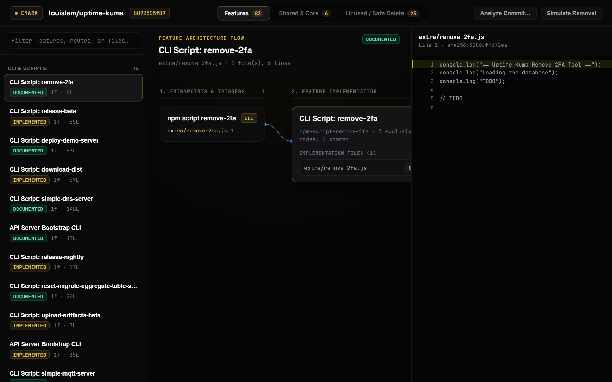

# Emara

Understand the codebase you are taking over. Emara identifies functionality in JavaScript, TypeScript, and Python repositories, points you to source locations, compares code with documentation, and flags potentially unused code for review.

It runs locally in deterministic mode with zero model requests. It parses the target repository rather than executing its application code. Static analysis can be wrong: source evidence helps you inspect a finding, not automatically trust it.

## See a real result before installing

[Read the reviewed room-booking sample](docs/samples/room-booking/README.md). It includes booking endpoints, links to exact source lines, one cleanup candidate, and known errors alongside the unchanged generated report. No installation is needed.

For example, Emara locates `DELETE /rooms/:id/:bookingId` at `api/routes/rooms.js:154`. The sample checks that handler against source and shows what the result does and does not establish.

Current status: early CLI for developer investigation. Documentation matching and legacy JSX import handling have known errors in this sample. Findings require review; no candidate is automatically safe to delete.

## Interactive Architecture Visualizer

Browse static snapshot demos in your browser with no installation. Each page shows features, shared subsystems, dependency flow, exact source excerpts, and a "Simulate Removal" preview of which files are statically exclusive to a feature. That preview is not deletion validation. The demos are fixed historical results for pinned commits, rebuilt by CI from SHA-256-pinned inputs in [`demo-data/`](demo-data/README.md); they do not analyze anything you enter.

- [**louislam/uptime-kuma** (Node + Express + Vue) →](https://mohamedswe.github.io/emara/uptime-kuma.html)
- [**fastapi/full-stack-fastapi-template** (FastAPI + React + SQLModel) →](https://mohamedswe.github.io/emara/fastapi-template.html)
- [**alan2207/bulletproof-react** (React / Next.js) →](https://mohamedswe.github.io/emara/bulletproof-react.html)
- [**Snapshot index →**](https://mohamedswe.github.io/emara/)

[](https://raw.githubusercontent.com/mohamedswe/emara/main/docs/media/emara-walkthrough.mp4)

[Watch or download the walkthrough demo (MP4)](https://raw.githubusercontent.com/mohamedswe/emara/main/docs/media/emara-walkthrough.mp4).

## Quickstart

Use a clean Git checkout of a JavaScript, TypeScript, or Python repository you know. In a Git work tree the scanner reads tracked files plus untracked files that are not ignored (`git ls-files --cached --others --exclude-standard`); tracked files are included even if they match `.gitignore`. Folders without Git (and submodule directories) are walked in full. Either way, `node_modules`, build output directories and `.env*` files are skipped. Keep output outside the target repository. The target application's dependencies do not need to be installed.

### Run from source

Requires Git and Node.js 22.6 or newer:

```sh
git clone https://github.com/mohamedswe/emara.git
cd emara
npm ci
npm run auditor -- "/absolute/path/to/repo" --deterministic --output "../mapping-output/functionality-audit.json" --graph "../mapping-output/graph.json"
```

Replace `/absolute/path/to/repo` with your target path. Windows accepts forward-slash paths such as `C:/projects/client-app`. Relative paths (the repository argument, `--output`, `--graph`, `--oracle`) resolve against the directory you run the command from; with `npm run auditor` that is the directory where you invoked npm. Without `--output`/`--graph`, results go to `./emara-output/` in that directory. In the example above you ran npm inside the Emara checkout, so `../mapping-output` sits next to it; choose another directory if that would put results inside your target.

### Interactive feature map visualizer

To start the local visualizer workspace and explore architectural flows:

```sh
npm run serve
```

Open `http://localhost:4173` in your browser (or use the URL printed by the server; pass another port with `npm run serve -- <port>` or `PORT`). The server listens on 127.0.0.1 only. It analyzes deterministically (no model requests) and parses rather than executes code. Accepted inputs are `owner/repo@commit` (or a GitHub commit/tree URL), which **fetches that public GitHub repository over the network** into a temporary directory, and local presets, which appear only if checkouts exist under `<temp>/emara-famous-repos/`.

The local server requires its per-session token for analysis requests, rejects foreign hosts/origins, and accepts JSON bodies up to 16 KiB. It runs one distinct analysis at a time and coalesces identical in-flight requests. Its retained payload cache is limited to eight entries and 64 MiB of serialized JSON; this does not cap a single analysis's peak memory or clone size.

### Run with Docker

If native package installation needs a compiler, use Docker instead. With Docker running, create an output directory outside the target first. Replace both absolute paths below; the target is mounted read-only:

```sh
docker run --rm -v "/absolute/path/to/repo:/repo:ro" -v "/absolute/path/to/output:/output" ghcr.io/mohamedswe/emara:latest /repo --deterministic --output /output/functionality-audit.json --graph /output/graph.json
```

Without `--output`/`--graph`, the container writes to `/output/emara-output/`.

Use absolute forward-slash Windows paths in PowerShell, for example `C:/projects/client-app:/repo:ro` and `C:/projects/emara-output:/output`.

The container runs as the unprivileged `node` user (UID 1000), not root. On Linux, the mounted output directory must be writable by that UID; if it is owned by another user, add `--user "$(id -u):$(id -g)"` to `docker run`. For deterministic runs you can also add `--network none --cap-drop ALL --security-opt no-new-privileges`.

Deterministic analysis is the default, makes zero model requests, and needs no API key—even when `DEEPSEEK_API_KEY` is present. Installation and image downloads require network access. To explicitly send source/context to DeepSeek, pass `--model-assisted` and provide the key; the CLI prints the provider endpoint before analysis. `--deterministic` remains supported and cannot be combined with `--model-assisted`.

Emara normally parses the target rather than executing its application code. Optional `--validate-dead-code` commands do execute code in a disposable copy, **not a security sandbox**: commands retain your user/container permissions and network access. Only run validation commands and repositories you trust.

Open `audit-report.md` in your chosen output directory when the run completes. The report starts with a Takeover Summary, then lists feature locations and review candidates. Keep `functionality-audit.json` and `graph.json` for structured evidence; `semantic-passes.json` records semantic-pass activity.

### Give feedback

Pick one feature you already understand and compare the report with its source. Does Emara locate it correctly? What does it miss or get wrong? Would the report give you a useful starting point on an unfamiliar repository?

[Share audit feedback](https://github.com/mohamedswe/emara/issues/new?template=audit-feedback.yml), including setup failures. One specific finding and what you expected is enough. If you received a personal invitation, replying to that email is fine too.

Audit artifacts can contain private names, paths, and documentation. Do not post client code, secrets, or full reports without reviewing them and obtaining permission. A redacted example or public reproduction is enough. Findings are leads for investigation, not proof of runtime behavior or permission to delete code.

The [sample's unchanged report](docs/samples/room-booking/audit-report.md) shows the current output. Read its [review notes](docs/samples/room-booking/README.md#where-the-report-gets-it-wrong) before interpreting the counts or verdicts.


## What it finds

- Features classified as implemented and documented, implemented but undocumented, partially implemented, documented but not implemented (DNI), or ambiguous.
- Dead-code candidates grouped by deterministic reachability class: product-reachable, startup-reachable, test-only, unproven public API, dynamic unknown, and disconnected candidate. A candidate is never declared safe to delete without isolated validation.
- Documentation-versus-code drift, including undocumented behavior, unsupported promises, partial promises, and documentation claims that cannot be mapped to implementation evidence.

## How findings are produced

The deterministic graph is the evidence boundary. Parsing, framework recognition, entrypoints, source ranges, SHA-256 content hashes, reachability, feature membership, statuses, and dead-code verdicts are computed in code. The language model never decides membership or verdicts; in assisted mode, DeepSeek can only propose human-readable labels and tightly bounded documentation mappings, which deterministic validation may reject. Gold-standard release oracles live in `bench/oracles/`, repeated-run checks require stable memberships, statuses, canonical IDs, and dead-code candidates, and assisted functionality audits make at most two DeepSeek-only requests. Deterministic mode makes none. See [the architecture](docs/architecture.md) for the full boundary.

## Historical benchmark results

These are historical release checks, not fresh measurements for every engine change or accuracy percentages. An oracle PASS covers selected hand-written expectations, not every finding. The current [reproducible sample](docs/samples/room-booking/provenance.md) includes a fresh run and its known failures.

| Repository | Features | Dead-code candidates | Oracle |
| --- | ---: | ---: | --- |
| Rentyl | 66 | 161 | PASS |
| AI-tutor | 28 | 17 | PASS |
| uptime-kuma | 102 | 89 | PASS (hand-derived) |

## Language & framework support

The current evidence frontends cover JavaScript and TypeScript (`.js`, `.jsx`, `.mjs`, `.cjs`, `.ts`, `.tsx`, `.mts`, and `.cts`) plus Python (`.py`, `.pyi`, and `.pyw`). Vue, Svelte, and Astro receive line-preserving analysis for their JavaScript/TypeScript script regions. Built-in conventions include Flask, FastAPI, Express, Next.js App Router, knex migrations, and npm-script entrypoints, with broader framework recognition documented in [the support contract](docs/FRAMEWORK_SUPPORT.md).

This is static analysis, not a language type checker or a runtime tracer. Go, Rust, Java, C#, Ruby, PHP, and other language families do not yet have source frontends. Generated code, reflection, `eval`, runtime route construction, monkey-patching, remote plugins, and unresolved dependency injection may remain unknown. Template semantics in Vue, Svelte, and Astro are shallower than JSX analysis, and detected frameworks are reported separately from fully understood conventions.

## Roadmap

- Maintainability scoring: dead-code ratio, unexplained-code percentage, test-only production code, and coupling.
- Change blast-radius analysis: show which features and shared subsystems can be affected when a file or symbol changes.
- Certification reports for reproducible release evidence and policy gates.
- Deeper language and framework support, with the same exact-source evidence requirements.

## Security

Read [SECURITY.md](SECURITY.md) before analyzing unfamiliar code or running validation commands.

## License

Software Auditor is source-available under the [Functional Source License 1.1, MIT Future License](LICENSE). It is free for non-competing use. Commercial use that competes with Software Auditor requires a paid license. Each released version becomes available under MIT on the second anniversary of its release.
